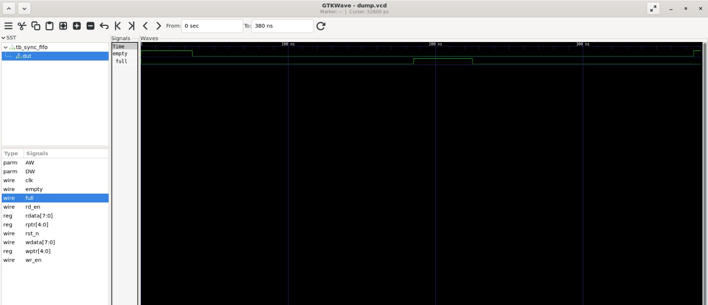
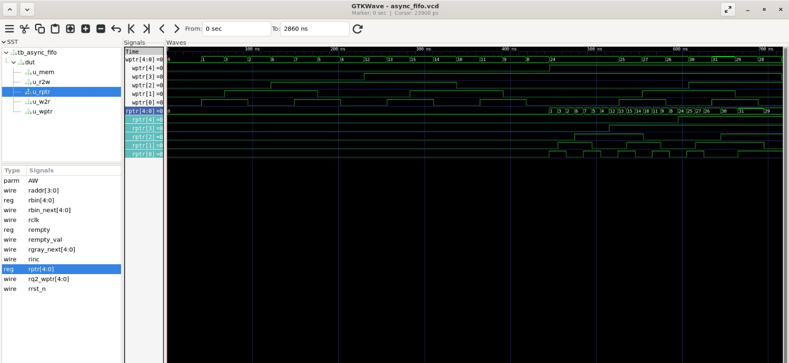
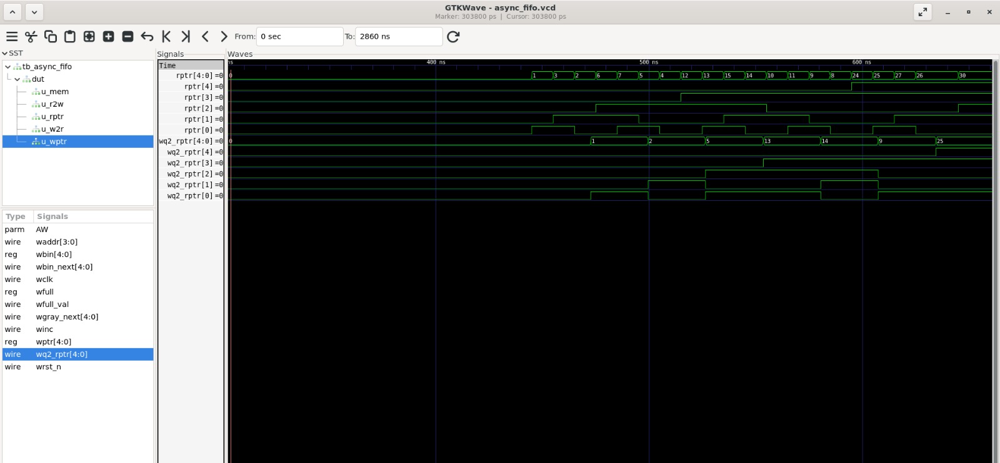
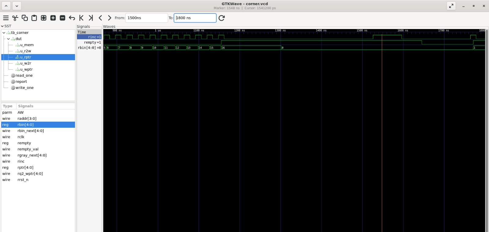
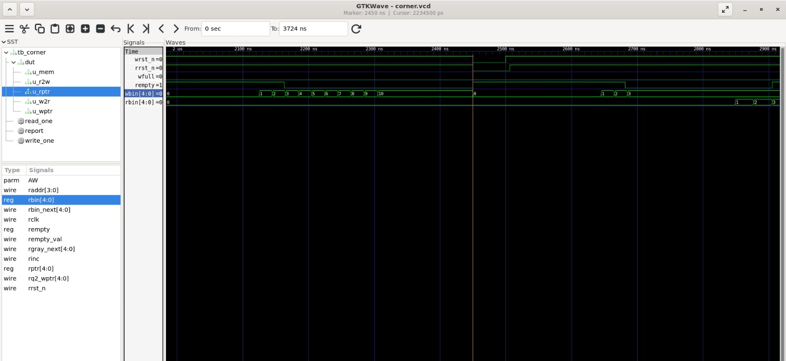

# Asynchronous FIFO in Verilog

A parameterized asynchronous FIFO that passes data safely between two
unrelated clock domains, built with Gray-coded pointers and two-flop
synchronizers. A synchronous FIFO is included as a baseline. Everything is
verified with self-checking Verilog testbenches in Icarus Verilog.

## Why this design exists

Chips often have parts running on different clocks, for example a sensor
interface at one speed and a processor at another. Data has to move from one
clock domain to the other. If a signal from one domain is sampled directly by
a flip-flop in the other domain, it can change inside that flip-flop's
setup/hold window and make it metastable: its output is neither a clean 0 nor
a clean 1 for an unpredictable time. A FIFO decouples the two sides. The
writer pushes data at its own speed and the reader pulls at its own speed.
Only the pointers need to cross between clock domains, and they are crossed
safely.

## Architecture

| Module | File | Function |
|---|---|---|
| `fifo_mem` | rtl/async_fifo.v | Dual-port memory (write on `wclk`, combinational read) |
| `wptr_full` | rtl/async_fifo.v | Write pointer, binary-to-Gray conversion, `wfull` flag |
| `rptr_empty` | rtl/async_fifo.v | Read pointer, binary-to-Gray conversion, `rempty` flag |
| `sync_r2w` | rtl/async_fifo.v | Two-flop synchronizer: read pointer into write domain |
| `sync_w2r` | rtl/async_fifo.v | Two-flop synchronizer: write pointer into read domain |
| `async_fifo` | rtl/async_fifo.v | Top level connecting everything |
| `sync_fifo` | rtl/sync_fifo.v | Single-clock baseline FIFO |

Parameters: `DW` (data width, default 8) and `AW` (address width, default 4,
so the depth is 16 words).

```
 WRITE DOMAIN (wclk)                      READ DOMAIN (rclk)
+------------------+                     +------------------+
| wptr_full        |-- wptr (Gray) ----> | sync_w2r         |--> rptr_empty
| (wbin, full)     |                     | (2 flops)        |    (rbin, empty)
|                  | <-- sync_r2w <------| <-- rptr (Gray)  |
+--------+---------+     (2 flops)       +--------+---------+
         | waddr, wdata                           | raddr
         +--------------> fifo_mem <--------------+
```

## How it works

**1. Extra pointer bit.** For a 16-slot FIFO the pointers are 5 bits wide, not
4. The lower 4 bits address the memory and the top bit counts laps. If the
pointers are fully equal the FIFO is empty. If only the top bit differs, the
writer has gone around once more than the reader, so the FIFO is full.

**2. Gray code.** Binary counting can flip many bits at once (011 to 100 flips
three). If the other clock samples at that moment, it can read a value that
was never valid. In Gray code only one bit changes per increment, so a
mis-sampled pointer is either the old value or the new value, never a wrong
one. Each side keeps a binary pointer for addressing memory and a Gray
pointer for crossing: `gray = (bin >> 1) ^ bin`.

**3. Two-flop synchronizer.** The first flop may go metastable, but it has one
full destination clock period to settle before the second flop samples it.
Logic only uses the output of the second flop.

**4. Flag rules, each computed in its own clock domain.**
- Empty (read domain): the read Gray pointer equals the synchronized write
  Gray pointer.
- Full (write domain): the write Gray pointer equals the synchronized read
  Gray pointer with its top two bits inverted. This is the Gray-code form of
  "top bit differs, lower bits equal".

**5. Conservative flags.** Because each side sees the other pointer about two
clocks late, `wfull` can stay high slightly longer than necessary and
`rempty` can stay high slightly longer than necessary. This costs a little
throughput but can never cause overflow, underflow, lost data or duplicated
data.

## Verification

All testbenches are self-checking: each word read is compared with the word
that was written, and the simulation prints PASS or FAIL.

| # | Test | Testbench | Result |
|---|---|---|---|
| 1 | Sync FIFO: fill to full, overflow attempt, drain to empty | tb_sync_fifo.v | PASS |
| 2 | Async: 100 words, fast writer (100 MHz), slow reader (about 37 MHz) | tb_async_fifo.v | PASS |
| 3 | Async: 100 words, slow writer, fast reader (clocks swapped) | tb_async_fifo.v (`-DSWAP`) | PASS |
| 4 | Write when full: extra writes ignored, first 16 words intact | tb_async_fifo_corner.v | PASS |
| 5 | Read when empty: read pointer does not move | tb_async_fifo_corner.v | PASS |
| 6 | Reset with data stored: FIFO empty, old data gone | tb_async_fifo_corner.v | PASS |
| 7 | Simultaneous read and write | tb_async_fifo_corner.v | PASS |

The full console output is saved in `docs/results.txt`.

### Waveforms

**Sync FIFO: full and empty flags**





`full` rises after the 16th write and `empty` rises after the 16th read. The
extra write of 255 while full is ignored.

**Async FIFO: Gray-coded pointers**





Each step of `wptr` and `rptr` changes exactly one bit.

**Async FIFO: synchronizer delay**





The synchronized pointer follows the original about two destination clock
cycles later.

**Corner case: write when full**


`winc` keeps pulsing after `wfull` goes high, but `wbin` stays at 16.

**Corner case: read when empty**





`rinc` is held high while `rempty` is high, and `rbin` does not move.

**Corner case: reset in the middle**





With 10 words stored, both resets go low and both pointers return to 0.

## How to run

Requires Icarus Verilog and GTKWave (`sudo apt install iverilog gtkwave`).

    make              # run all four simulations
    make sync         # sync FIFO only
    make async        # async FIFO, fast writer / slow reader
    make async_swap   # async FIFO, slow writer / fast reader
    make corner       # corner-case tests
    make clean        # remove generated files

View waveforms with `gtkwave async_fifo.vcd` or `gtkwave corner.vcd`.

## Project structure

    rtl/    sync_fifo.v, async_fifo.v
    tb/     tb_sync_fifo.v, tb_async_fifo.v, tb_async_fifo_corner.v
    docs/   waveform screenshots and results.txt
    Makefile
    README.md

## Limitations

- Verified in RTL simulation only. There is no gate-level simulation, formal
  proof or synchronizer MTBF analysis.
- Fixed two-flop synchronizers, with no almost-full or almost-empty flags.
- Read data is combinational from the memory array, which suits FPGA
  distributed RAM but would need a registered output for block RAM.

## What I learned

- The pointer is one bit wider than the memory address. The extra bit tells
  "full" apart from "empty", because in both cases the lower bits are equal.
- Gray code changes only one bit per step, so a pointer sampled by the other
  clock is either the old value or the new one, never garbage.
- The full and empty flags are late on purpose because of the two-flop
  synchronizer. A late flag is safe; an early one would lose or repeat data.
- A waveform can look flat when the viewer is zoomed to the wrong time range.
  I learned to zoom to the real range before judging a result.
- `force` is a reserved Verilog keyword. A syntax error that points at an
  ordinary-looking line can be a name clash.
- A self-checking testbench that compares every word gives a clear PASS or
  FAIL, which is more reliable than checking waveforms by eye.
